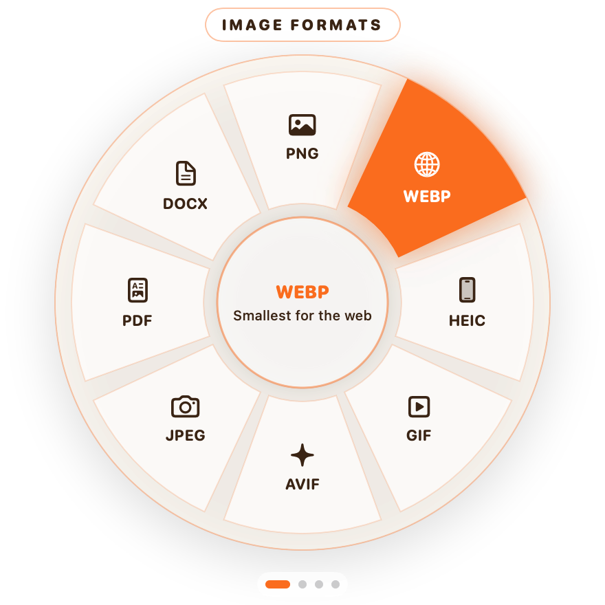
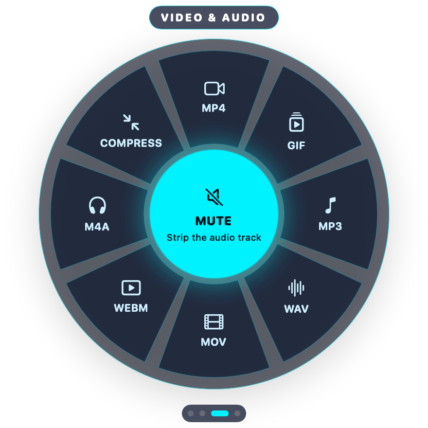

<p align="center">
  
  
</p>

<h1 align="center">DragWheel</h1>

<p align="center">
  <b>Hold Shift while dragging a file. Pick a format on the wheel. Let go.</b><br>
  A gesture-based file converter for macOS and Windows that works entirely on your computer.
</p>

<p align="center">
  <a href="../../releases/latest">Download</a> ·
  <a href="#install">Install</a> ·
  <a href="#privacy--security">Privacy & security</a> ·
  <a href="#build-from-source">Build from source</a> ·
  <a href="#română">Română</a>
</p>

---

## What it does

Drag any file in Finder or File Explorer and press **Shift**. A wheel opens under your cursor, already showing the page that fits your file. Drop the file on a slice and the result appears next to the original. The original is never changed.

| Page | Actions |
| --- | --- |
| **Image formats** | PNG · WEBP · HEIC · GIF · AVIF · JPEG · PDF · DOCX · TIFF (plus BMP in the converter window) |
| **Tools & edit** | Compress · Strip GPS/EXIF · Remove background · Add background · Edit · Annotate · Crop · Redact · Preview |
| **Video & audio** | MP4 · GIF · MP3 · WAV · MOV · WEBM · M4A · Compress · Mute |
| **PDF & documents** | To PDF · Compress · Split · Merge · OCR text · To images · To Word · Print · Preview |

- **Switch pages** by pressing Shift again, pressing Tab or scrolling. **Option/Alt + Shift** jumps straight to Tools. **Esc** cancels.
- **Converter window** (from the menu bar or tray icon) converts many files at once and can convert images straight from the clipboard.
- **Notifications** show the size before and after, with **Open**, **Show in folder** and **Undo**. Undo moves the result to the Trash or Recycle Bin.
- **Five themes:** Liquid Tangerine, Cyber Neon, Emerald Forest, Midnight Obsidian, Sunset Rose.
- **Never overwrites anything:** files are named `photo.webp`, then `photo_1.webp`, `photo_2.webp` …

## Install

Download the latest version from the [Releases page](../../releases/latest).

### macOS 14 Sonoma or later

1. Download `DragWheel-<version>-macOS.dmg`, open it, and drag **DragWheel** to **Applications**.
2. The first time you open it, macOS warns that the app is from an unidentified developer. DragWheel is free and open source, and isn't paid-registered with Apple. To open it anyway:
   1. Open it once and close the warning.
   2. Go to **System Settings → Privacy & Security** and click **Open Anyway**.
3. When asked, allow DragWheel in **Privacy & Security → Accessibility**. The app needs this to notice Shift, Tab and Esc while you drag. It never reads what you type.
4. Video, audio and WebP need two free tools from [Homebrew](https://brew.sh): `brew install ffmpeg webp`. Everything else works without them.

### Windows 10 (2004+) and Windows 11, 64-bit

1. Download `DragWheel-<version>-Windows-Setup.exe` and run it. It installs only for your user and doesn't need administrator rights.
2. Windows SmartScreen may say it "protected your PC", because the app isn't code-signed. Click **More info → Run anyway**.
3. DragWheel starts in the notification area next to the clock. Drag a file in File Explorer and press Shift.
4. Video and audio need ffmpeg: `winget install Gyan.FFmpeg`. Restart DragWheel after installing it.

There's also a `Windows-portable.zip` if you'd rather not install anything. Unzip it and run `DragWheel.exe`.

## Privacy & security

- **No internet use.** DragWheel has no accounts, analytics, telemetry, ads or update pings, and it never uploads your files.
- **Your files stay yours.** It reads only the files you drop on it, and writes new files next to them or in the folder you choose. Nothing is deleted. Undo moves files to the Trash or Recycle Bin.
- **No admin rights.** Windows installs per user. On macOS the only permission is Accessibility, used for the three keys mentioned above.
- **Verifiable builds.** Every release is built by [GitHub Actions](.github/workflows/release.yml) from the public source and ships with `SHA256SUMS.txt`. You can also check that a download really came from this repository:
  ```bash
  gh attestation verify DragWheel-1.0.0-macOS.dmg --repo nico43245/DragWheel
  ```

See [PRIVACY.md](PRIVACY.md) and [SECURITY.md](SECURITY.md) for details, including how to report a vulnerability.

## How it works

| | macOS | Windows |
| --- | --- | --- |
| Language | Swift, SwiftUI, AppKit | C#, .NET 10, WPF |
| Images | ImageIO (built in), `cwebp` for WebP | Magick.NET |
| PDF | PDFKit | PDFsharp, PdfPig, Windows.Data.Pdf |
| OCR | Vision | Windows.Media.Ocr |
| Remove background | Vision | U²-Net model via ONNX Runtime |
| Video / audio | ffmpeg (Homebrew) | ffmpeg (winget) |

Both apps can also be scripted from the command line:

```bash
/Applications/DragWheel.app/Contents/MacOS/DragWheel --run toWEBP photo.png
```

```powershell
DragWheel.exe --run mergePDF a.pdf b.pdf scan.jpg
```

## Build from source

**macOS** needs Xcode 15 or later:

```bash
macos/build.sh                       # → macos/build/DragWheel.app
macos/scripts/smoke-test.sh          # runs every conversion on sample files
```

**Windows** needs the [.NET 10 SDK](https://dotnet.microsoft.com/download):

```powershell
windows/scripts/fetch-model.ps1      # downloads the background-removal model, checks its SHA-256
dotnet test windows/DragWheel.slnx
windows/scripts/publish.ps1          # app folder, portable zip and installer (with Inno Setup 6)
```

## Uninstall

- **macOS:** quit DragWheel from the menu bar and drag it from Applications to the Trash. To remove its settings too, run `defaults delete io.github.nico43245.dragwheel`.
- **Windows:** use **Settings → Apps → DragWheel → Uninstall**. This also removes its settings and the start-at-sign-in entry.

## Credits

Inspired by [Dragged](https://github.com/ozertugrul/Dragged) by ozertugrul (MIT) and by the Tangerine app for Mac. DragWheel is an independent implementation written from scratch. Third-party components and their licenses are listed in [THIRD-PARTY-NOTICES.md](THIRD-PARTY-NOTICES.md).

## License

[MIT](LICENSE)

---

## Română

**DragWheel** convertește fișiere direct pe calculatorul tău, pe Mac și pe Windows. Ții **Shift** apăsat în timp ce tragi un fișier, alegi formatul pe roată și îi dai drumul. Rezultatul apare lângă original.

- **Instalare:** descarci de la [Releases](../../releases/latest). Pe Mac, la prima deschidere mergi la *System Settings → Privacy & Security → Open Anyway*. Pe Windows, la avertismentul SmartScreen apeși *More info → Run anyway*.
- **Video/audio:** pe Mac rulezi `brew install ffmpeg webp`, iar pe Windows `winget install Gyan.FFmpeg`.
- **Siguranță:** aplicația nu folosește internetul, nu are conturi și nu trimite nimic nicăieri. Nu șterge niciun fișier: „Undo” îl mută doar în Coș.
